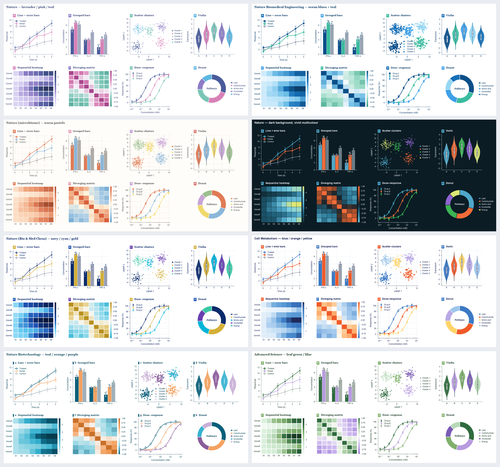
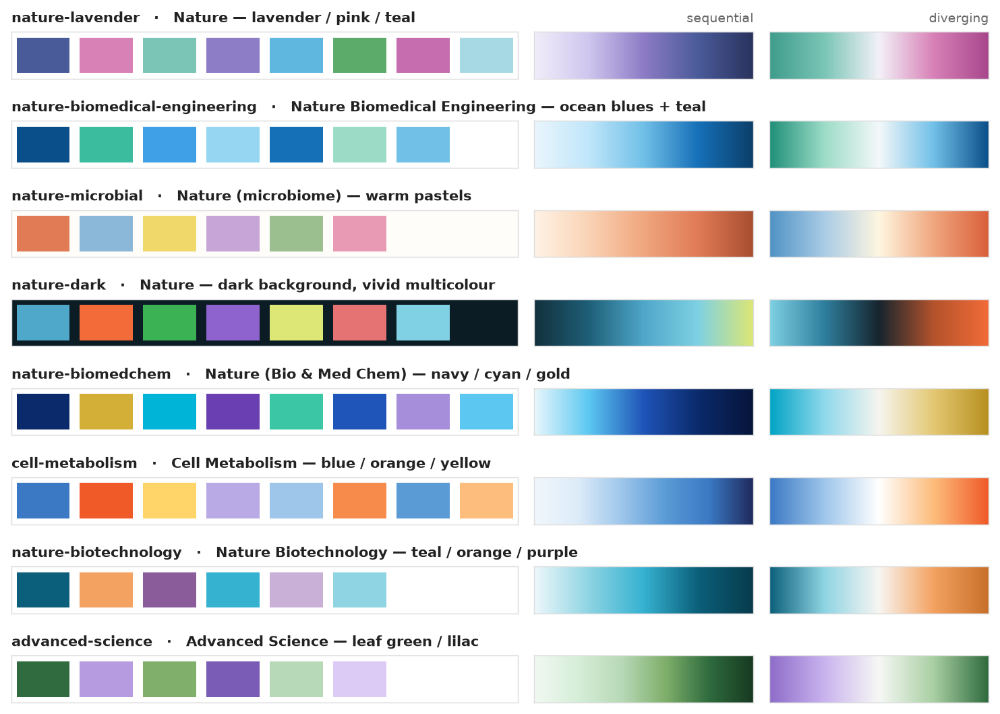
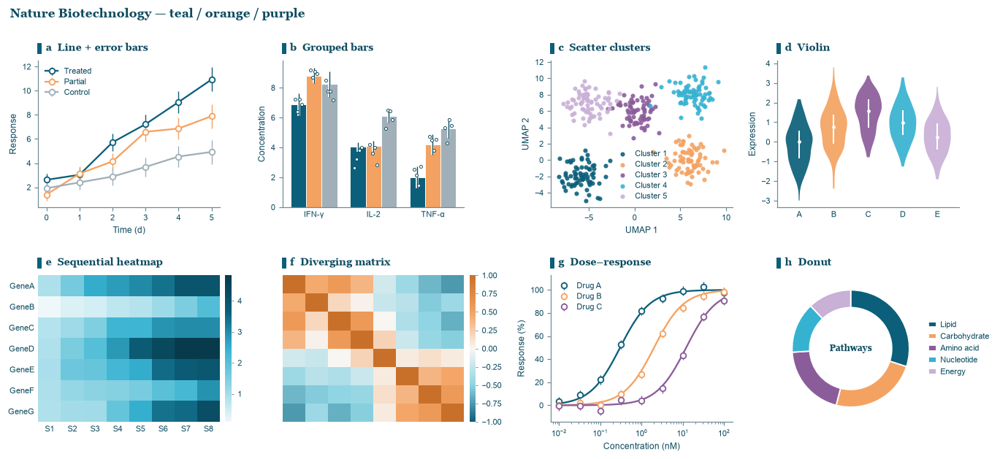
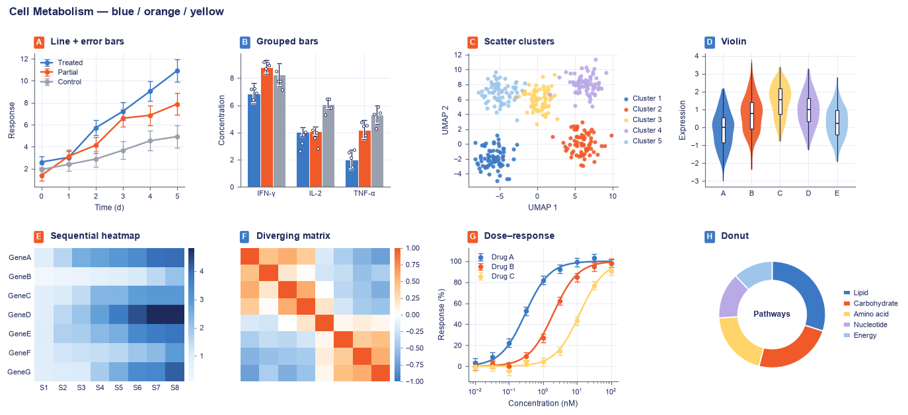
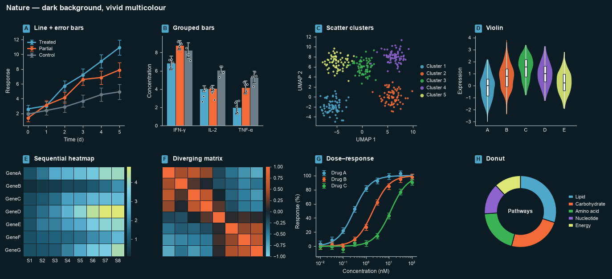

# journal-figure-themes

A Claude skill that gives every scientific figure in a conversation one consistent,
journal-inspired look. Name a journal once ("Nature Biotechnology style", "template Cell
Metabolism") and Claude applies that template to every figure it draws afterwards.

A template is the whole chart style, not just a palette: colours, title typeface, panel-letter
badges, grid, line and marker weights, error bars, how violins and heatmaps are built, where the
legend sits.





## Templates

| Key | Inspired by | Look |
|---|---|---|
| `nature-lavender` | Nature | indigo, lavender, pink, teal; serif titles, multicolour badges, white-gapped heatmaps |
| `nature-biomedical-engineering` | Nature Biomedical Engineering | ocean blues and teal; heavy lines, large markers, dashed cluster ellipses |
| `nature-microbial` | Nature (microbiome cover) | warm pastels on cream; light grid, filled cluster ellipses |
| `nature-dark` | Nature (dark cover) | vivid colours on dark navy; for slides and posters |
| `nature-biomedchem` | Nature (Bio & Med Chem) | navy, cyan, purple, gold accent; fine lines, light grid |
| `cell-metabolism` | Cell Metabolism | blue against orange; sans bold titles, light grid |
| `nature-biotechnology` | Nature Biotechnology | teal, orange, purple; accent-bar labels, hollow markers, minimal |
| `advanced-science` | Advanced Science | leaf green and lilac; quiet, thin lines |

The same data in three templates:





Previews of all eight are in [`journal-figure-themes/assets/previews`](journal-figure-themes/assets/previews).

## Install

**Claude Code** — copy the skill folder into your personal skills directory:

```bash
git clone https://github.com/Sabir-OUSSAOUI/journal-figure-themes.git
cp -r journal-figure-themes/journal-figure-themes ~/.claude/skills/
```

**Claude apps (claude.ai, desktop)** — zip the inner `journal-figure-themes` folder and upload it
under Settings → Capabilities → Skills.

Requires Python with `matplotlib` and `numpy` wherever Claude runs code. `plotly` is optional.

## Use

Ask for a figure and name a journal:

> Make a dose–response figure for my Cell Metabolism paper: two drugs and a vehicle control.

> Utilise le template Nature Biomedical Engineering pour toutes mes figures.

Claude states the active template once and keeps it for the rest of the conversation. Switch at
any time ("switch to NBT", "passe en sombre"). Short names work: Nature, NBE, NBT, Cell, adv sci,
dark, microbiome.

## Use the helper without Claude

`scripts/journal_theme.py` is a standalone module:

```python
from journal_theme import apply_theme

t = apply_theme("nature-biotechnology")            # sets matplotlib rcParams
colors = t.assign(["Control", "sgRNA-1", "sgRNA-2"])   # control is drawn grey

fig, ax = plt.subplots(figsize=t.figsize(1), constrained_layout=True)
for group, y in data.items():
    t.lineplot(ax, days, y, yerr=sd[group], label=group, color=colors[group])
t.panel(ax, "a", "Cell viability")
t.legend(ax)
fig.savefig("viability.pdf")
```

Helpers: `panel`, `lineplot`, `curve`, `points`, `bars`, `scatter`, `violin`, `heatmap`, `donut`,
`legend`, `suptitle`, `figsize`, `assign`. There is also `plotly_template(key)`.

```bash
python journal_theme.py list                 # template keys
python journal_theme.py show cell            # colours and style as JSON (for R, SVG, D3…)
python journal_theme.py demo nbt out.png     # eight chart types in one template
python journal_theme.py gallery out.png      # palette sheet
```

## Add or change a template

Edit `THEMES` in `scripts/journal_theme.py`. Each entry has colour fields and a `style` dict that
overrides `STYLE_DEFAULT` (documented at the top of the file). Regenerate the previews with the
`demo` and `gallery` commands.

## Tests

`journal-figure-themes/evals` holds four test cases in the layout `claude plugin eval` reads.
From the skill folder:

```bash
claude plugin eval . --allow-tools Write,Edit,Bash --scaffold
```

These are billed model runs.

## Disclaimer

The templates are colour and style schemes inspired by journal cover art. They are not official
style guides, and this project is not affiliated with or endorsed by Springer Nature, Cell Press,
Wiley or any journal named here. Check each journal's author guidelines before submitting.

## License

MIT — see [LICENSE](LICENSE).
